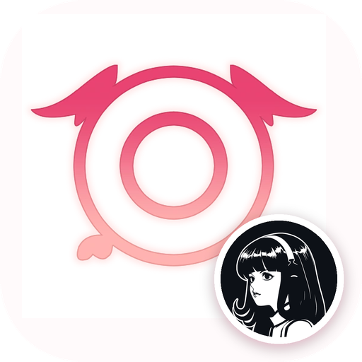

<p align="center"></p>

# hermes-koharu-plugin

[](https://github.com/ve3dy/hermes-koharu-plugin/actions/workflows/ci.yml)

Translate manga with [Hermes Agent](https://github.com/nousresearch/hermes-agent), using the latest [Koharu](https://github.com/koharu-rs/koharu) headless on your own machine. No window and no server, the plugin runs Koharu's full pipeline as a command each time.

## Install

**macOS / Linux**

```bash
git clone https://github.com/ve3dy/hermes-koharu-plugin.git
cd hermes-koharu-plugin
./scripts/install.sh
```

**Windows** (PowerShell)

```powershell
git clone https://github.com/ve3dy/hermes-koharu-plugin.git
cd hermes-koharu-plugin
powershell -ExecutionPolicy Bypass -File scripts\install.ps1
```

The first install builds Koharu's headless runner from the latest Koharu release, which takes a few minutes (it also installs Rust if needed). To update Koharu, run the installer again. It rebuilds only when there's a new release. Preview without changing anything with `--dry-run` (`-DryRun` on Windows).

### Requirements

| OS | Build tools | GPU (Koharu needs one of these) |
|---|---|---|
| macOS | Xcode Command Line Tools (`xcode-select --install`) | Apple Silicon (Metal) |
| Linux | `sudo apt install build-essential clang pkg-config libfontconfig1-dev libssl-dev` (Fedora and Arch commands are printed by the installer) | NVIDIA (CUDA), AMD (ROCm) or Vulkan on x86_64. CUDA on ARM64 |
| Windows | Visual Studio Build Tools (C++) and LLVM (`winget install LLVM.LLVM`) | NVIDIA (CUDA), AMD (ROCm) or Vulkan |

Koharu has no CPU-only mode on Linux and Windows, so a machine without a supported GPU can install the plugin but can't translate.

## Pick the translation model

The plugin uses the same settings as the Koharu desktop app (`~/.koharu/config.toml`).

1. Open Koharu → Settings → Translation.
2. Choose a model and the target language.

To use your own OpenAI-compatible server (MLX-Serve, LM Studio, Ollama), set it under Settings → Providers → OpenAI-compatible first.

## Use

Ask Hermes:

> translate the pages in ~/Manga/chapter-12 to English and send them to me

Translated pages are saved to `~/Koharu/exports/`. Long chapters keep running in the background. Hermes checks back on the job until it's done (Hermes cuts a single tool call off at 7 minutes).

## Settings

Set with `hermes config set plugins.entries.koharu.settings.<key> <value>`, then run `hermes gateway restart`.

| Key | Default | What it does |
|---|---|---|
| `export_dir` | `~/Koharu/exports` | Where translated pages go |
| `timeout` | `3600` | Max seconds per run |
| `runner` | set by the installer | Path to `koharu-batch` |

## Fix problems

| Problem | Fix |
|---|---|
| `runner not found` | Run `./scripts/install.sh` |
| Translation fails | Ask Hermes for `koharu_status`. It shows the model and whether its server is reachable |
| Wrong language | Change it in Koharu → Settings → Translation, or name the language in your request |
| `no device supports the requested runtime features` | No supported GPU was found (see Requirements). Update the GPU driver, or install Vulkan drivers |

## Uninstall

```bash
./scripts/uninstall.sh            # keeps the source build cache
./scripts/uninstall.sh --purge    # removes everything the installer added
```

On Windows use `scripts\uninstall.ps1` (add `-Purge` to remove everything).

Neither command touches the desktop app's settings or models.

## How it works

Koharu releases ship as a desktop app, but their source contains the complete pipeline. The installer:

1. Builds a small runner (`runner/`) against the latest Koharu release's source.
2. Leaves every upstream file unchanged.
3. Uses the last release known to work if a new one doesn't build yet.

The runner shares models and settings with the desktop app.

## Develop

Needs Python 3.11+ (the Hermes venv qualifies).

```bash
python3 -m unittest discover -s tests
```

## License

The plugin is MIT licensed. Koharu is MIT OR Apache-2.0. The icon combines Koharu's logo with the Hermes Agent icon (MIT).

See also [SECURITY.md](SECURITY.md) and [CHANGELOG.md](CHANGELOG.md).
